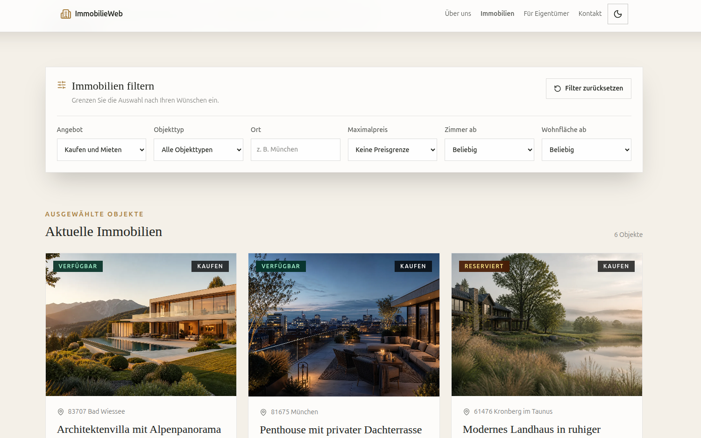
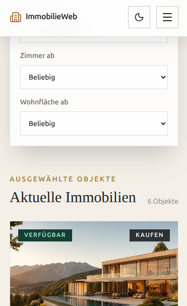

# 🏡 ImmobilieWeb – Website eines Immobilienbüros

ImmobilieWeb ist ein deutschsprachiges Frontend-Lernprojekt für ein fiktives Immobilienbüro. Die Anwendung verbindet die Suche nach Kauf- und Mietobjekten mit Kontaktmöglichkeiten und einer mehrstufigen Bewertungsanfrage für Eigentümer.

🌐 **Website:** [ImmobilieWeb öffnen](https://immobilie-web.netlify.app/)

**Projektstatus:** Die Anwendung verwendet Beispieldaten. Kontakt-, Objektanfrage- und Bewertungsformulare zeigen nach erfolgreicher Prüfung eine Demo-Bestätigung. Sie übertragen keine Formulardaten an einen Server. Eine automatische Wertermittlung findet nicht statt.

## 📸 Vorschau

### Startseite


<details>
<summary>Immobilienkatalog und mobile Ansicht anzeigen</summary>

### Immobilienkatalog mit Suchfiltern



### Mobile Ansicht



</details>

## 🎯 1. Ausgangslage und Ziel

Immobiliensuchende benötigen einen übersichtlichen Zugang zu passenden Angeboten und deren wichtigsten Informationen. Eigentümer brauchen einen klaren Einstieg, um eine Bewertung oder einen Verkauf anzufragen.

Die Anwendung richtet sich an:

- **Käufer und Mieter:** Angebote filtern, vergleichen und Objektdetails ansehen.
- **Eigentümer und Verkäufer:** Angaben zur Immobilie schrittweise erfassen und eine Bewertungsanfrage vorbereiten.
- **Interessenten des Immobilienbüros:** Leistungen, Ansprechpartner und Kontaktmöglichkeiten finden.

Ziel ist eine responsive, verständliche Oberfläche mit wiederverwendbaren Komponenten, klaren Handlungsaufforderungen und einer hochwertigen Immobilienästhetik.

| Bereich             | Funktionsumfang                                                    |
| ------------------- | ------------------------------------------------------------------ |
| Startseite          | Schnellsuche, ausgewählte Immobilien, Leistungen und Kundenstimmen |
| Immobilienkatalog   | Filter nach Kauf/Miete, Ort, Objekttyp, Preis, Zimmern und Fläche  |
| Objektdetails       | Bildergalerie, Eckdaten, Energieausweis und Anfrageformular        |
| Immobilienbewertung | Vier Schritte: Objekttyp, Angaben, Adresse und Kontakt             |
| Weitere Seiten      | Über uns, Kontakt, Impressum und Datenschutz                       |
| Darstellung         | Mobile Navigation sowie heller und dunkler Modus                   |
| Bewertungen         | Eigene Demo-Bewertungen im lokalen Browserspeicher                 |

🌙 **Dark Mode:** Über das Sonnen-/Mondsymbol im Header lässt sich zwischen hellem und dunklem Modus wechseln. Die Auswahl wird im Browser gespeichert.

🧭 **Navigation:** Seitenwechsel ohne vollständiges Neuladen über TanStack Router und sanftes Scrollen innerhalb der Seite.

## 🛠️ 2. Architektur und Tools

### ⚙️ Tech Stack


| Werkzeug                       | Aufgabe                                                                  |
| ------------------------------ | ------------------------------------------------------------------------ |
| React 19 und TypeScript        | Funktionale Komponenten, typisierte Datenmodelle und Props               |
| Vite 8                         | Entwicklungsserver und Produktions-Build                                 |
| Tailwind CSS 4                 | Responsive Gestaltung, Farben, Abstände und Zustände                     |
| TanStack Router                | Typisiertes, dateibasiertes Routing und URL-Suchparameter                |
| Framer Motion                  | Scroll-/Parallax-Animationen unter Berücksichtigung reduzierter Bewegung |
| Lucide React                   | Icons für Navigation, Formulare und Immobiliendaten                      |
| ESLint und TypeScript-Compiler | Statische Codeprüfung und Typprüfung                                     |

Das Routing erfolgt dateibasiert mit TanStack Router. Die Routen liegen in `src/routes/`; der Route Tree wird automatisch generiert. Der `RouterProvider` ist in `src/main.tsx` eingebunden.

### 🧩 Komponentenstruktur nach Atomic Design

```text
src/
├── components/
│   ├── atoms/       # Brand, Eyebrow, ThemeToggle
│   ├── molecules/   # PropertyCard, QuickSearchForm
│   ├── organisms/   # SiteHeader, FilterBar, ContactForm
│   └── templates/   # SiteTemplate, LegalPageTemplate
├── pages/           # konkrete Seiten und deren Zusammensetzung
├── routes/          # Routen, Suchparameter und Route-Loader
├── types/           # Datenmodelle und Formular-Interfaces
├── data/            # Beispieldaten, Bildzuordnung und Ladefunktion
├── utils/           # Laufzeitprüfungen und Browserspeicher
└── assets/          # lokale Bilder
```

Kleine Bausteine werden zu größeren UI-Bereichen zusammengesetzt. Das `SiteTemplate` stellt Header, Hauptinhalt und Footer bereit; über `Outlet` erscheint die aktuelle Seite. So bleiben Seitenaufbau und Navigation konsistent.

### 🔄 State-Management

- **Lokaler React-State (`useState`):** Formulareingaben, Fehlermeldungen, Formularschritte, Navigation und Ladezustände. Props und Callbacks verbinden die Komponenten.
- **URL als Zustand:** Katalogfilter stehen in Suchparametern. Gefilterte Ansichten lassen sich dadurch teilen und nach einem Neuladen wiederherstellen. `validateSearch` prüft zulässige Werte und positive Zahlen.
- **Seiteneffekte (`useEffect`):** Laden der Katalogdaten und Reaktion auf Systemeinstellungen. Filterergebnisse werden aus Daten und Filtern abgeleitet.
- **`localStorage`:** Speichert die Designauswahl und lokal abgegebene Bewertungen. Diese Bewertungen sind nur im jeweiligen Browserprofil verfügbar.

Ein zusätzlicher globaler Store wie Redux oder Zustand wird derzeit nicht benötigt. TanStack Query wird nicht eingesetzt.

### 🗂️ Datenquellen und Datenfluss

Der Katalog lädt `public/data/properties.json` per `fetch`. Die Antwort wird zunächst als `unknown` behandelt und mit `isProperty` zur Laufzeit geprüft. Bildschlüssel werden über `src/data/propertyImages.ts` lokalen WebP-Dateien zugeordnet.

Startseite und Objektdetails verwenden dagegen statische Objektdaten aus `src/data/properties.ts`. Ansprechpartner und Unternehmensangaben liegen ebenfalls lokal in `src/data/`. Ein Route-Loader sucht anhand von `$propertyId` das Objekt und den zugehörigen Ansprechpartner. Unbekannte Objekte führen zu einer Nicht-gefunden-Ansicht.

## ✅ 3. Validierung und Fehlerbehandlung

Die Validierung ist ohne Zod oder Formularbibliothek umgesetzt: mit eigenen TypeScript-Funktionen, regulären Ausdrücken und HTML-Constraints.

- **Kontaktformular:** `validateForm` prüft ausgefüllte Namen, E-Mail-Format, Anliegen, mindestens zehn Zeichen Nachricht und Datenschutzeinwilligung.
- **Bewertungsformular:** `validateStep` prüft vor dem nächsten Schritt unter anderem positive Fläche/Zimmerzahl, Baujahr zwischen 1800 und dem aktuellen Jahr, Adresse, fünfstellige Postleitzahl sowie Kontaktdaten und Einwilligung.
- **Objektanfrage:** `required` und `type="email"` liefern HTML-Gültigkeitsregeln. Beim Absenden wird das erste Feld mit `:invalid` gesucht und fokussiert.
- **Kundenbewertung:** Name und Text besitzen Mindest- und Höchstlängen. Beim Einlesen gespeicherter Bewertungen werden zusätzlich Datenstruktur, Bewertung von 1 bis 5 und eindeutige IDs geprüft.

`noValidate` unterdrückt in den Kontakt-, Bewertungs- und Objektanfrageformularen automatische Browsermeldungen. Stattdessen erscheinen eigene deutsche Fehlermeldungen. Im Kontaktformular verhindert `validateForm` bei ungültigen Eingaben die Bestätigung.

Der Katalog zeigt einen Ladestatus, bei Ladefehlern eine Meldung mit „Erneut versuchen“ und bei fehlenden Treffern einen passenden Hinweis. Beschädigte oder nicht speicherbare lokale Bewertungen werden ebenfalls mit einer Fehlermeldung behandelt.

**Grenzen:** Telefonnummern haben keine eigene Formatprüfung. Clientseitige Prüfungen lassen sich umgehen; bei einer Serveranbindung müssen alle Eingaben zusätzlich serverseitig validiert werden.

## 🧪 4. Qualitätssicherung und Testing

### 🔍 Technische Prüfungen

Am **18.10.2026** wurden für diese Dokumentation erfolgreich ausgeführt:

- `npm run lint` – ESLint ohne gemeldete Fehler.
- `npm run build` – TypeScript-Prüfung und Vite-Produktions-Build erfolgreich.

Es ist derzeit kein automatisiertes Unit-, Komponenten- oder End-to-End-Testskript eingerichtet. Lint und Build ersetzen keine Funktionsprüfung im Browser.

### 📱 Responsive Design und Barrierefreiheit

Die Gestaltung verwendet mobile Ausgangslayouts und Tailwind-Breakpoints. In [audit.md](audit.md) und [todo.md](todo.md) sind frühere Prüfungen bei **320, 375, 768, 1024 und 1440 Pixel** als abgeschlossen vermerkt. Dort sind auch mobile Navigation, erreichbare CTAs und die Vermeidung horizontalen Scrollens dokumentiert. Konkrete Geräte-/Browsermodelle und einzelne Testläufe sind nicht protokolliert. Eine neue Geräteprüfung erfolgte für diese README nicht.

Im Code sind unter anderem ein Sprunglink zum Hauptinhalt, semantische Landmarks wie `header`, `nav`, `main` und `footer`, beschriftete Formularfelder, Fokuszustände und Meldungen mit `role="status"` beziehungsweise `role="alert"` vorhanden. Bewegungsreduktion wird bei Animationen berücksichtigt.

Die vorhandene Audit-Notiz nennt für den **16.08.2026** Lighthouse-Werte von **77 Performance, 100 Barrierefreiheit, 100 Best Practices und 100 SEO**, außerdem LCP 4,8 Sekunden und CLS 0. Diese Angaben stammen aus der bisherigen Checkliste; ein neuer Lighthouse-Lauf wurde nicht durchgeführt. Ein Lighthouse-Wert allein belegt keine vollständige Barrierefreiheit.

### 📋 Manueller Prüfablauf für die nächste Abnahme

1. Alle Seiten bei den fünf Zielbreiten öffnen; Navigation, Bilder, CTAs und horizontalen Scroll prüfen. Auf verfügbaren echten Mobilgeräten gegenprüfen und Geräte/Browser protokollieren.
2. Nur mit Tastatur navigieren: Sprunglink, Menü, Filter, Galerie und Formulare bedienen; Fokus und Überschriftenhierarchie kontrollieren.
3. Formulare leer, mit ungültiger E-Mail, zu kurzer Nachricht und ohne Einwilligung absenden; Fehlermeldungen und erfolgreiche Demo-Bestätigung prüfen.
4. Filter kombinieren, URL neu laden und Filter zurücksetzen; unbekannte Objekt-URL aufrufen.
5. Laden der JSON-Datei im Browser blockieren und Wiederholungsversuch prüfen; lokale Bewertungen speichern, neu laden und Speicherfehler testen.

## 💡 5. Reflexion und nächste Schritte

| Entscheidung/Kompromiss                        | Konsequenz und möglicher Ausbau                                                                                                   |
| ---------------------------------------------- | --------------------------------------------------------------------------------------------------------------------------------- |
| Frontend-Demo ohne Backend                     | Der UI-Ablauf ist demonstrierbar; echte Anfragen benötigen API, serverseitige Validierung und Speicherung.                        |
| Lokaler State und eigene Validierung           | Wenige zusätzliche Abhängigkeiten und direkt nachvollziehbare Regeln; bei mehr Formularen gemeinsame Regeln oder Zod prüfen.      |
| JSON für Katalog, TypeScript-Daten für Details | Einfacher Demonstrationsaufbau; doppelte Pflege kann Abweichungen erzeugen. Eine gemeinsame Datenquelle ist ein nächster Schritt. |
| Bewertungen im Browserspeicher                 | Funktionieren ohne Konto/Server, sind aber weder öffentlich geteilt noch geräteübergreifend verfügbar.                            |
| Große Immobilienbilder und Animationen         | Unterstützen die Gestaltung, belasten aber die Ladezeit. Responsive Bildgrößen und LCP-Optimierung haben Priorität.               |
| Bisher manuelle Funktionsprüfungen             | Automatisierte Tests für Validierung, Filter und zentrale Nutzerabläufe sollen weitere Änderungen absichern.                      |

Vor einem produktiven Einsatz sind eine erneute Geräte- und Barrierefreiheitsprüfung sowie die fachliche Prüfung der rechtlichen Texte erforderlich. Impressum und Datenschutzerklärung sind **Entwürfe**.

## 🔐 6. KI-Unterstützung und Datenschutz

### 🤖 Einsatz von ChatGPT/Codex

ChatGPT/Codex wurde für folgende Aufgaben genutzt:

- **Texte:** Erstellung aller Projekttexte einschließlich UI-Texte, Immobilienbeschreibungen, Beispielkundenstimmen, rechtlicher Entwürfe und README.
- **Architektur:** Unterstützung bei Atomic Design, Ordnerstruktur und Aufteilung von Komponenten, Seiten und Routen.
- **Design:** Unterstützung bei der visuellen Gestaltung der Website.
- **Lernen und Codeanalyse:** Erklärung der Validierung und Vorbereitung auf technische Prüfungsfragen.
- **Prüfungen und Ideen:** Ausführen von Lint/Build sowie Vorschläge für zukünftige Erweiterungen.

### 🔒 Umgang mit Daten

Das Projekt verwendet fiktive Beispieldaten. Für Demo-Eingaben sind nur synthetische, anonymisierte oder freigegebene Daten vorgesehen; Bewertungen bleiben im lokalen Browserspeicher. Persönliche Daten und Zugangsdaten gehören weder ins Repository noch in KI-Eingaben. Rechtliche Texte sind fachlich zu prüfende Entwürfe; Bildrechte müssen vor Veröffentlichung geklärt werden.

## 🚀 7. Lokal starten

Voraussetzung sind eine zur eingesetzten Vite-Version passende Node.js-Version und npm. Die Prüfungen oben liefen mit **Node.js 24.14.0 und npm 11.9.0**.

```bash
git clone https://github.com/YanaKhariebova/immobilie-web.git
cd immobilie-web
npm install
npm run dev
```

Die vom Entwicklungsserver ausgegebene lokale URL im Browser öffnen.

| Befehl            | Zweck                                                         |
| ----------------- | ------------------------------------------------------------- |
| `npm run dev`     | Entwicklungsserver starten                                    |
| `npm run lint`    | Code mit ESLint prüfen                                        |
| `npm run build`   | TypeScript prüfen und Produktionsdateien in `dist/` erstellen |
| `npm run preview` | Erstellten Produktions-Build lokal ansehen                    |

Weitere Projektdokumente: [Anforderungen](spec.md), [Audit-Checkliste](audit.md), [Entwicklungsstand](todo.md) und [Projektregeln](AGENTS.md).
